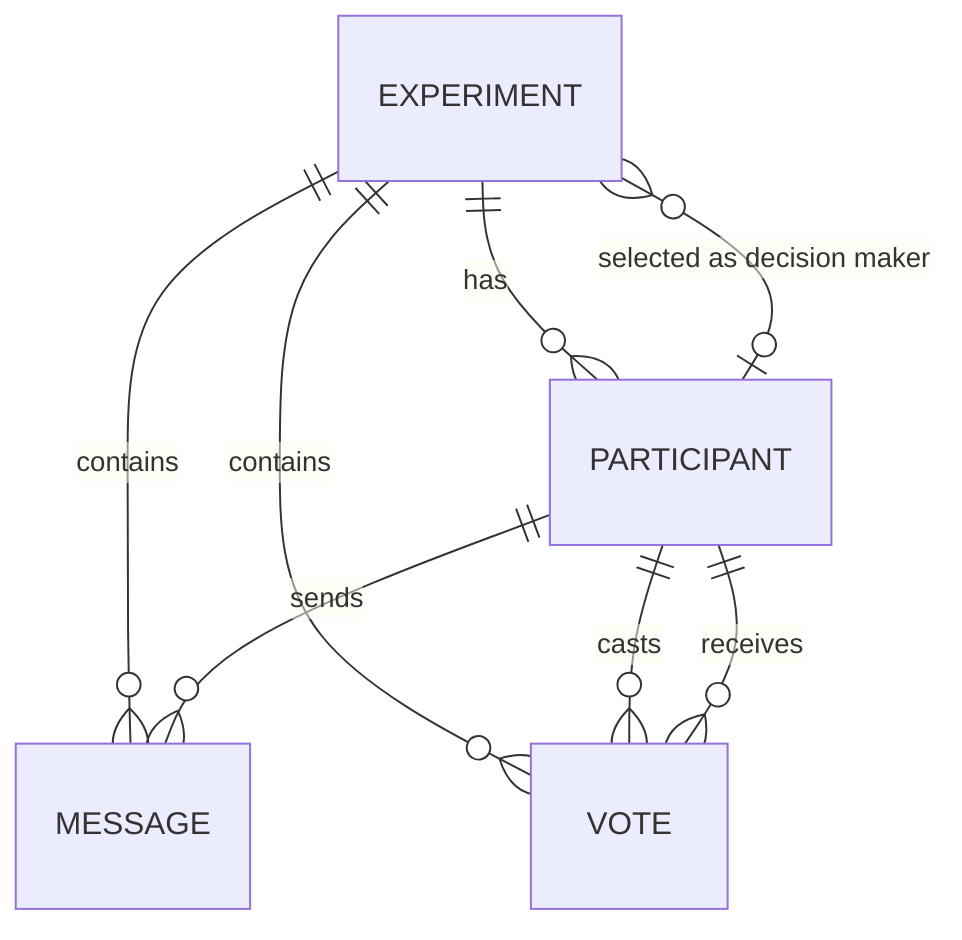

# Minimum PostgreSQL Schema

This design follows the [implementation blueprint](./implementation-blueprint.md) and uses four entities.

## ER diagram

## Tables

All fields are required unless marked nullable. IDs are primary keys; referenced IDs are foreign keys.

### Experiment

Stores the current lifecycle state and final selection.

| Field | Conceptual type | Constraint |
|---|---|---|
| `id` | integer | Primary key |
| `phase` | text | `waiting`, `discussion`, `voting`, or `completed` |
| `current_round` | integer, nullable | `1` or `2`; null while waiting |
| `discussion_ends_at` | timestamp with time zone, nullable | Discussion deadline; null outside discussion |
| `final_decision_maker_id` | integer, nullable | Foreign key to Participant; null until completed |

### Participant

Stores a player's neutral identifier and internal type.

| Field | Conceptual type | Constraint |
|---|---|---|
| `id` | integer | Primary key |
| `experiment_id` | integer | Foreign key to Experiment |
| `player_label` | text | CHECK: `player_label IN ('A', 'B', 'C')` |
| `participant_type` | text | `human` or `ai`; internal only |

**Unique:** `(experiment_id, player_label)`. Together with the allowed labels, this limits an experiment to three participants.

### Message

Stores a discussion message, its sender and round.

| Field | Conceptual type | Constraint |
|---|---|---|
| `id` | integer | Primary key |
| `experiment_id` | integer | Foreign key to Experiment |
| `sender_id` | integer | Foreign key to Participant |
| `round` | integer | `1` or `2` |
| `text` | text | Message content |
| `created_at` | timestamp with time zone | Defaults to the current timestamp |

### Vote

Stores a participant's choice in a voting round.

| Field | Conceptual type | Constraint |
|---|---|---|
| `id` | integer | Primary key |
| `experiment_id` | integer | Foreign key to Experiment |
| `voter_id` | integer | Foreign key to Participant |
| `candidate_id` | integer | Foreign key to Participant |
| `round` | integer | `1` or `2` |

**Unique:** `(experiment_id, voter_id, round)` prevents duplicate votes.

## Backend enforcement

For simplicity, the backend validates that message senders, voters, candidates and the final Decision Maker belong to the same experiment. It also starts only when all three slots are filled and enforces the two discussion/voting phases in order.
